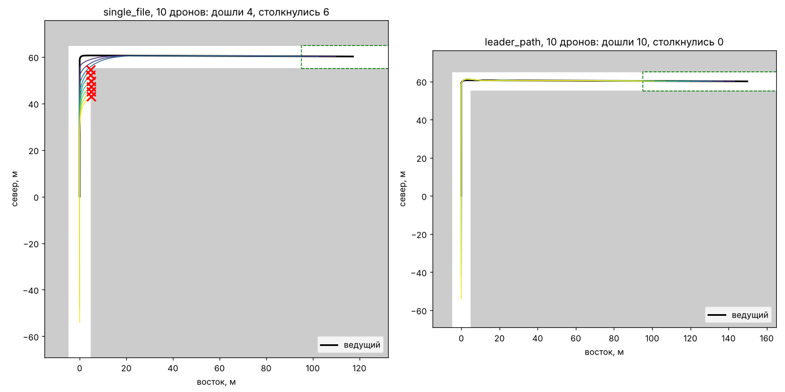

# MultiUAV

Среда для отработки управления группой дронов одним оператором. Оператор ведёт
один дрон, остальные летят по подключаемым алгоритмам на Python. Алгоритм получает
объективные положения соседей и выдаёт команду в стиле RC Override.

Картинку и физику даёт [Cosys-AirSim](https://github.com/Cosys-Lab/Cosys-AirSim)
на Unreal Engine 5. Для отладки алгоритмов без видеокарты есть упрощённый
симулятор без графики: в нём же работают автоматические тесты.



Слева колонна из 10 дронов «гуськом»: каждый летит прямо на предыдущего, хвост
срезает угол и врезается в здание. Справа те же 10 дронов «по следу ведущего»:
все проходят поворот там же, где прошёл ведущий.

## Быстрый старт без Unreal

```bash
python3 -m venv .venv && . .venv/bin/activate
pip install -e ".[plot,dev]"
pytest -q
python -m multiuav compare scenarios/corner.yaml --plot corner.png
```

`compare` прогоняет оба встроенных алгоритма на группах из 3, 5, 7 и 10 дронов и
печатает, сколько дошло до финиша, сколько столкнулось и за какое время.

Один прогон с журналом и картинкой:

```bash
python -m multiuav run scenarios/corner.yaml --drones 7 --algorithm leader_path \
    --out runs/corner7 --plot runs/corner7.png
```

## Запуск в Cosys-AirSim

Установка под Debian описана в [docs/setup_debian.md](docs/setup_debian.md). Коротко:

```bash
python -m multiuav settings scenarios/blocks_demo.yaml --write   # ~/Documents/AirSim/settings.json
# запустить симулятор, затем:
python -m multiuav run scenarios/blocks_demo.yaml --backend cosys
python -m multiuav run scenarios/blocks_demo.yaml --backend cosys --leader gamepad
```

## Свой алгоритм

Алгоритм — это класс с одним методом. Пример с пояснениями лежит в
[examples/my_algorithm.py](examples/my_algorithm.py).

```python
from multiuav.algorithms.base import FollowerAlgorithm
from multiuav.types import RcOverride

class MyAlgorithm(FollowerAlgorithm):
    def step(self, me, others, leader, t) -> RcOverride:
        pred = self.predecessor(others, leader)  # ближайший впереди дрон в строю
        ...
        return RcOverride(roll=1500, pitch=1600, throttle=1500, yaw=1500)
```

Подключается без правки кода проекта:

```bash
python -m multiuav run scenarios/corner.yaml --algorithm path/to/my_file.py:MyAlgorithm
```

или в сценарии: `followers: {algorithm: path/to/my_file.py:MyAlgorithm, params: {...}}`.

### Соглашения

- Координаты мировые, NED, как в AirSim и ArduPilot: x — север, y — восток,
  z — вниз (`state.altitude` = высота). Метры, секунды, радианы.
- Курс 0 — север, положительный — поворот по часовой стрелке.
- `DroneState`: `id`, `position`, `velocity`, `yaw`, `collided`. Дрон 0 — ведущий.
- `RcOverride`: четыре канала 1000..2000, 1500 — центр. Режим с удержанием высоты:
  `roll` > 1500 — вправо, `pitch` > 1500 — вперёд, `throttle` > 1500 — вверх
  (1500 — держать высоту), `yaw` > 1500 — поворот вправо.
- Если удобнее думать скоростями, `self.velocity.command(me, скорость_север_восток,
  курс, высота)` переведёт их в стики.

## Сценарии

Сценарий — YAML-файл: число дронов, стартовая колонна, кто ведёт (`waypoints` —
автопилот по точкам, `gamepad` — оператор), алгоритм ведомых, здания и финишная
зона. Смотри [scenarios/corner.yaml](scenarios/corner.yaml).

## Устройство

| Модуль | Что делает |
| --- | --- |
| `multiuav/types.py` | `DroneState`, `RcOverride` |
| `multiuav/control.py` | толкование стиков, помощник «скорость → стики» |
| `multiuav/algorithms/` | `single_file`, `leader_path`, `waypoints`, `gamepad`, загрузка своих |
| `multiuav/manager.py` | цикл группы, журнал и метрики прогона |
| `multiuav/backends/kinematic.py` | упрощённый симулятор со зданиями-коробками |
| `multiuav/backends/cosys.py` | Cosys-AirSim |
| `multiuav/cosys_settings.py` | settings.json для Cosys-AirSim из сценария |

## План

1. Стенд: Cosys-AirSim на Debian, группа летает из Python. **← сейчас**
2. Оператор: геймпад, FPV-видео с дрона.
3. Ведомые: интерфейс алгоритма, «гуськом» и «по следу ведущего». (основа уже есть)
4. Город с плотной застройкой, маршрут, метрики.
5. Экран оператора: видео с нескольких дронов, мини-карта, раскладки.
6. Серии экспериментов и сравнение.
